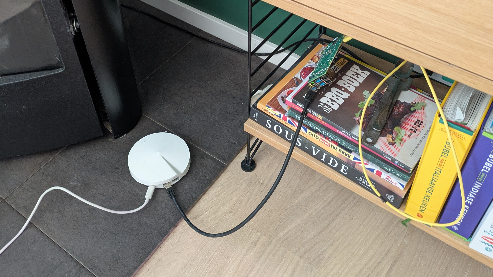

+++
date = '2025-07-04T13:00:46+02:00'
title = 'Terraforming my PI'
summary = "Dusting off my PI, to deploy my blog"
tags = ['infrastructure', 'learning']
image = { src = 'professional-rack-mount.jpg', thumb = 'professional-rack-mount-thumb.jpg', alt = 'A professionially racked server' }
+++

A couple of years ago I bought a [Raspberry PI](https://www.raspberrypi.com/), the 4B 8gb to be precise.
I'm not entirely sure why I got it, I believe there were numerous reasons:

- Setup PI hole to block advertising
- Host game servers (Valheim was the plan)
- Perhaps host some small projects

It had been collecting dust for a year or two now, as the valheim server,
besides being complicated to setup (not ARM) had issues with running out of sync with the client.
As I was extremely lazy, I quickly abandoned working with it.

This changes today!
While writing this I'm setting up my PI to host my blog, 
(more about that in [my Hello World blog post](/blog/2025/06/hello-world)).

First steps, I installed the latest version of [Raspberry Pi OS Lite](https://www.raspberrypi.com/software/operating-systems/), which today is based on Debian 12 (Bookworm).
I simply used the Raspberry Pi Imager to install the Lite version, and setup SSH/Wifi during the install, because I don't have the cables to connect it to a monitor, nor do I want to.

## Problem 1 No wifi?

I had been very careful to setup my image correctly, and I also read a couple of outdated blog posts so I had modified my image a few times (previously one could put some files in the boot partion to setup WIFI/SSH). And yet still, Wifi was not working on boot.

After plugging the Pi onto my network using an actual network cable, I was at least able to SSH into it, and login using username/password (I'll disable this later).
After trying some suggested ways to setup WIFI, I kept getting errors, of the adapter not being available.
Finally I found someone suggesting to use `rfkill` which lists the bluetooth and WIFI adapter and their blocked status.
It seemed my WIFI was soft blocked, which typically meant my country settings were wrong.
Simply going into `sudo raspi-config` and setting my country to `SE` Sweden, solved it, I was pretty sure I did this during setup, but perhaps I missed it on the last flash?


*Professionally racking my Raspberry including Ethernet*

Anyways, time to move on into the real thing.
I wanted to try out terraform for deploying my simple static website; why? Why not!
Honestly I want to learn how to set it up, and it would possibly be a good way to version whatever I'm going to deploy on my Pi.

## How does I Terror form?

I've been struggling through setting things up, the Terraform documentation to me was not very easy to follow;
So I ended up getting most of my inspiration (and simply copying files at times) 
from [Saurav Sahu's kube-homelab](https://github.com/mrsauravsahu/kube-homelab),
which I did not follow exactly, 
for example I tried to use newer packages of Terraform and K3s which required me to setup things slightly different, in any case it was super helful.

So what is it I wanted to achieve?
I had a few simple things I wanted:

- Try out Pihole, I wanted to do this for a long time
- Deploy my static generated website [my blog generated by Hugo](/blog/2025/06/hello-world/).

Anyone who is familliar with Terraform will probably not agree on using it for such a tiny project,
I am a beginner, but I'm also aware what I'm doing seems off, but it's a learning exercise and it seems to work well for this hobby setup.
Anyways for those who just want to see the config files, check it out on [Github](https://github.com/msegers/terraform-pi)


First things first, to do anything on the PI early on we need access,
Before I was using SSH to connect to the pi, and sudo when needed,
to avoid storing any passwords we add the public keys from my machine to the Pi's trusted keys.
Now I can ssh into the PI as root and break stuff; 
I think this is something that should be improved
because it seems like a massive security flaw, but perhaps I can look at that later.

The first step is to be able to deploy anything, so we run some shell scripts through 
`ssh_resource`, we'll be configuring some environment stuff, installing docker and k3s.
Things I ran into when setting this up,
k3s required us to add a memory group to raspberry's config.
So I used `sed` to append `/boot/firmware/cmdline.txt`.

```
sed -i '1s/$/ cgroup_memory=1 cgroup_enable=memory/' /boot/firmware/cmdline.txt
```

This is probably something that came with a later version k3s,
because it wasn't a requirement in Sahu's setup, perhaps it wasn't needed at all,
but I see warning, I fix!

Next up was installing Docker, 
easy enough a simple `curl` command piped into `sh` to run the installer.

```
"curl -sSL https://get.docker.com/ | sudo sh"
```

With Docker available we can install `k3s` which is similar to installing Docker,
except there are some extra params to set, which I mostly configured similar to the pi host.
I can probably clean this up a little.

```
"curl -sfL https://get.k3s.io | INSTALL_K3S_VERSION='v1.33.0+k3s1' sh -s - server --docker --write-kubeconfig-mode 644 --disable=traefik --tls-san=${each.value.host} --bind-address=${each.value.host} --advertise-address=${each.value.host} --node-ip=${each.value.host}"
```

Then there's replacing the localhost IP the k3s' config to the host IP,
unfortunately I could't get Sahu's implementation to work here either,
so I changed it into a `ssh_resource` again and threw in another sed command.

```
sed -i -e \"s/127.0.0.1/${host-goes-here}/g\" /etc/rancher/k3s/k3s.yaml
```

After this K3's is configured, at this point I copied the kube configuration to my desktop, so I can use [k9s](https://k9scli.io/) to inspect the pods/ingresses etc.

## Terraforming the actual aps

I would suggest to look at the actual config, some of the config I stole, has some prep by defining a list of helm charts in repositories to deploy.
I basically added the same for my personal blog, currently I refer to it by filesystem since it's checked out in the same directory.
To summarize, I run some helm charts to deploy a docker image, so it's easy to scale up if I ever would want that (unlikely with a single pi, it might explode).
After that's been configured some ingress config is being added to route to the apps.

## Now what

This setup seems to work for me, I use terraform currently to update my blog, it seems a bit tedious.
Bit first I'd like to see if the structure I used makes any sense, perhaps do some refactors there.

In the future I'd probably want to setup some CI for my blog, on my PI of course, so I can automatically deploy new versions when pushing.
I'd likely add some more projects for funsies, I can see the idea to build some mobile app backend for example.

In any case, thanks for reading.
