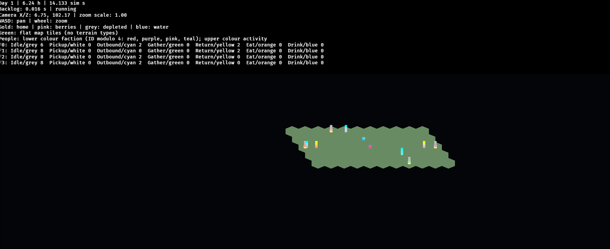

+++
title = 'Building an agentic development workflow for Tribute'
date = '2026-10-26T10:30:16+01:00'
draft = true
tags = ['ai', 'development', 'rust']
summary = 'Working notes on using coding agents to plan, implement, review and integrate changes to Tribute, a Rust game prototype.'
image = { src = 'image.png', thumb = 'thumb.png', alt = "Tribute's native client showing a green hexagonal map with coloured faction and activity markers and a status overlay." }
+++

*Working notes for a post about delegating bounded engineering tasks to coding agents while building Tribute. Not a finished article, and not a claim that agents replaced the programmer.*

Tribute is a Rust game prototype: a headless foraging simulation, a CLI runner, and an optional native client built with Bevy. It has enough interconnected systems to make a useful testbed for a development workflow, without pretending that a small indie project is the same as a large production codebase.

These notes describe the repository as I found it around 2026-10-26. I've tried to separate what is implemented from what is still an experiment, a policy, or an open question.

*The optional native client, showing the simulation's hex map, faction/activity markers and debug status panel. This is the kind of change the workflow is meant to deliver.*

[TODO: add a short personal opening — what prompted the experiment, what the first attempts looked like, and what I expected versus what actually happened.]

## 1. Why experiment with agentic development?

- Tribute is ambitious relative to its size: simulation time, needs, resources, travel, inventory, activity state, a CLI, and a graphical observer all interact.
- The original draw was not "write more code per hour". It was the possibility of delegating a bounded engineering task — with context, constraints, checks and a review boundary — and getting back something I could evaluate.
- There is a useful distinction between:
  - using an AI assistant interactively, where I stay in the editor and ask for the next small step; and
  - handing an agent a defined task in an isolated worktree, then reviewing the result as I would a human contributor's patch.
- An independent game project is a reasonable place to experiment because:
  - I own the design and can make scope decisions quickly;
  - the feedback loop is concrete (compiler, tests, headless runs, visual inspection);
  - mistakes are recoverable;
  - there is no team process to disrupt while I learn what works.
- The goal was a repeatable delivery process, not an autonomous programmer. The interesting question is not "can an agent write Rust?" — it plainly can. The interesting question is whether a task can move from definition to merged change with less manual coordination, without lowering the quality bar.
- [TODO: expand on the difference between code generation and delegated engineering work, with a concrete example from Tribute.]
- [TODO: what did I think would be hardest before starting? Was I right?]

## 2. From prompts to an actual workflow

### Task definition and tracking

The workflow is built around a small task board in the repository, not around a chat transcript.

- `tasks/INDEX.md` is coordinator-owned. It lists task IDs, titles, status, and dependencies.
- Each task is a Markdown file with a stable structure:
  - goal and non-goals;
  - approval and scope;
  - acceptance criteria;
  - dependencies;
  - references to the relevant code and docs;
  - validation commands;
  - a handoff section with verified tree/branch/HEAD, checks, session IDs, review results, and open questions.
- Statuses are `Draft → Ready → In progress → Review → Done`; `Blocked` can interrupt.
  - `Ready` means the scope is approved, not merely "someone wrote a ticket".
  - `Review` means the work is waiting for review or changes.
  - `Done` means validated and human-accepted as ready to merge. GitHub tracks the actual merge separately.
- Dependencies are explicit. In the records I inspected, a dependency meant the earlier work had to be merged, not merely accepted in chat or sitting in an open PR. A stacked plan needs an explicit decision.
- The coordinator owns the index. Workers update only their own task handoff, which avoids concurrent workers racing to rewrite shared status rows.

Reference points: `tasks/INDEX.md`, `tasks/TEMPLATE.md`, `docs/workflow.md`.

### Refinement before implementation

- Nontrivial work is refined with me before implementation: scope, non-goals, acceptance criteria, dependencies and checks.
- Substantial specifications get an independent review before implementation. The point is to catch an ambiguous or over-broad task while it is still cheap to change.
- Trivial changes can skip the full process after a brief plan, but new dependencies, architecture changes or ambiguous requirements still need approval.
- Once a task is approved and its dependencies are satisfied, the agent continues through implementation, checks, fresh review and PR preparation without asking for routine confirmation at every phase. That continuation is bounded by the task scope and the stop conditions.
- [TODO: expand on what a good task brief looks like, with a before/after example.]
- [TODO: an example where refinement caught a bad assumption before code was written.]

A useful concrete example is the person/needs work. It was split into bounded slices (stable identity and trip membership, person-owned activity and independent trips, then per-person needs and home meals) rather than one large "make NPCs work" task. Each slice had its own dependencies, checks and PR. The split was a technical decomposition within an approved direction, not a new game-design decision.

### Delegation and roles

Tribute uses OpenCode V2 with project-local configuration.

- The default agent is the coordinator.
- There are separate roles for:
  - coordination and refinement;
  - nontrivial implementation;
  - simple documentation/mechanical work;
  - independent review.
- In the configuration I inspected, all roles used the same model and reasoning effort, with worker/reviewer step caps rather than token or cost budgets. The exact model is in `opencode.json`; I don't want these notes to imply that the specific model choice is the important part.
- The coordinator reads the index and the assigned task, verifies the tree, and moves into the feature worktree before delegating. Child sessions inherit the working directory, so this step matters: delegation does not create isolation by itself.
- The worker gets the task path, approved scope, dependencies, tree/branch, acceptance criteria, checks, publishing boundary and output contract. Missing context is supposed to produce `Blocked`, not invented requirements.
- Skills (`task-refinement`, `task-execution`, `review-handoff`) hold the detailed procedures. They are loaded on demand rather than repeated in every prompt.
- The coordinator keeps one worker at a time by default. A separate rolling-queue policy allows more concurrency only with explicit human authorization.

Reference points: `opencode.json`, `.opencode/agents/`, `.opencode/skills/`, `docs/workflow.md`.

### Worktrees, checks and publishing

- Each task gets a named feature branch in its own linked Git worktree. The base is a refreshed `origin/main`, not a possibly stale local `main`.
- Before work starts, the coordinator verifies the actual directory, non-detached branch name, HEAD against the intended base, and clean status. Tool success alone is not treated as verification.
- One implementation task per tree. Worktrees isolate checkouts, but they do not make conflicting work safe: shared files and semantic dependencies still have to be serialized.
- The worker implements the approved scope and records actual check results in the task handoff.
- A fresh reviewer inspects the change. The reviewer is read-only: no repository code execution, no edits, no delegation. The coordinator owns repair/re-review cycles, with a cap of three per gate.
- Publishing uses `scripts/push_branch.py`, which only permits named feature branches from a linked worktree, requires a clean tree, verifies the push remote, and never force-pushes. PRs are opened with `gh`.
- Human merge remains exclusive. Agents may commit, push feature branches and open PRs; they do not merge or enable auto-merge.
- CI is split by change type:
  - Rust changes run `cargo fmt --check`, `cargo check`, `cargo test`, and `cargo clippy --all-targets -- -D warnings`.
  - Harness changes run the Python harness checker, its unit tests, and a whitespace check.
  - Path filters avoid running the Rust suite for documentation-only changes, and vice versa.

`[TODO: Architecture diagram showing task → agent → implementation → validation → review/integration]`

The current flow, in one line:

**Refine → spec review → human approval → worktree implementation → checks → independent review → PR → human merge.**

### A concrete task shape

A typical substantial task in this repository looks like:

- one clear outcome, such as "render the flat hex world" or "reconcile people by stable ID";
- explicit non-goals to prevent a visual feature from turning into a terrain system, or a queue policy from turning into a scheduler;
- named files/modules the worker may touch;
- acceptance criteria that include tests and, where relevant, human inspection;
- commands to run, with broader regression checks before handoff;
- a handoff that records what actually passed, what remains unverified, and the next action.

That structure is doing a lot of the work. The agent is not being asked to infer a product direction from a vague request; it is being asked to execute a bounded slice and report evidence.

## 3. The difficult part isn't generating code

Generating a plausible patch is the easy part. Keeping a growing codebase coherent is harder.

### Architectural consistency

Tribute's simulation owns authoritative state. Clients and debug views query snapshots; external actions go through validated commands. That sounds simple until an agent is asked to add a visual feature.

Examples from the actual work:

- The native client originally had to reconcile render entities by stable `PersonId`, not by snapshot vector index. If the vector reorders, index-based reconciliation silently attaches the wrong entity to the wrong person. The task brief called this out, and the tests covered reordering, add/remove and activity updates.
- Person execution state was consolidated into one authoritative, data-bearing activity model with phase-owned progress. That prevents an agent from adding a second mutable representation of "what this person is doing" just because it is convenient for one feature.
- The visual client converts simulation `(x, y)` into render `(x, 0, y)` through a small local helper. The coordinate spaces and the conversion direction are explicit; the simulation does not grow render-specific fields.
- The hex world uses the simulation's finite axial map and `Tile::centre()` geometry. A plausible-looking rectangular grid would have been the wrong answer even if it rendered nicely.

These are the kinds of constraints that need to be in the task or the architecture documentation. If they are not, an agent can produce code that compiles, passes a narrow test, and still undermines the design.

### Preventing unnecessary refactors

- Broad refactors are tempting because they make the immediate patch easier to write.
- The task template's non-goals are partly a defence against this: no new abstraction framework, no speculative scheduler, no terrain system for a rendering slice, no gameplay redesign while fixing a CLI output issue.
- The project prefers simple solutions and measured performance over speculative infrastructure. That preference has to be stated; it is not a default property of an agent.
- [TODO: add a concrete example of an unnecessary refactor that was rejected or reverted.]
- [TODO: how often did I have to narrow a task after seeing the agent's plan?]

### Interconnected Rust modules

- A seemingly local change can touch `model`, `simulation`, the CLI, tests and README together. The person/needs slices were serialized partly because they all touched the same foundation.
- Shared-code work is serialized even when the agents are in separate worktrees. Isolation prevents checkout collisions, not logical conflicts or stale assumptions.
- Integration order matters. A task that depends on a person-identity change is not safely implementable against a branch that merely contains an open PR for that change.
- The coordinator has to reconcile the task index from current evidence, not copy a stale index from a concurrent branch.

### Compiling is not the same as correct

This is the most important lesson from the records I inspected.

- A visual slice compiled and passed its automated checks, but still needed a human to inspect the actual rendered map, markers, lighting, zoom and resize behaviour. A compiled binary is not evidence that geometry is visible or correct.
- A need/gathering change passed initial tests, then independent review found numeric edge cases around depletion progress. The repair cycles were useful precisely because "all tests passed" was not accepted as task completion.
- One task's rust-analyzer MCP analysis disagreed with successful Cargo checks for feature-gated client code. The tool was configured and available, but it was not treated as the source of truth. The compiler and the actual feature build were.
- A native performance sample can be real and still not establish the intended target. In one task the available machine was a high-end desktop, and the budget-hardware validation remained explicitly pending rather than being inferred from a good result.

So the workflow spends a lot of effort on evidence: actual commands, actual feature builds, actual rendering inspection, actual measurement conditions. The agent's summary is a claim until it is backed by those.

- [TODO: add a specific anecdote where an agent reported success but had missed an acceptance criterion.]
- [TODO: note how often reviews requested changes, and whether the pattern changed over time.]

## 4. Dependencies and parallel agents

This is where the workflow gets more interesting than the implementation.

### What is actually implemented

- The default is single-task execution with one worker at a time.
- A bounded rolling-queue policy exists in the repository. It allows a future run, with explicit human authorization, to refill independent implementation slots and publish a separate PR per task.
- The default concurrency in that policy is two independent slots. It requires:
  - only approved `Ready` tasks with satisfied dependencies;
  - a recorded selection scope, stop conditions and publishing authority;
  - a separate verified worktree, branch, worker, checks, fresh review and PR per task;
  - serialization of shared-code edits;
  - coordinator-owned, reconciled index writes;
  - global stops for model/access/allowance/runtime failures and run limits.
- This is a documented policy plus harness support, not an autonomous scheduler. The records explicitly say that no live multi-task queue was executed as part of that change.

### What the actual run looked like

The repository contains a queue ledger from an authorized multi-ticket run. The authorization allowed up to two independent slots, but the ledger repeatedly records one selected implementation at a time.

The reason was not a lack of authorization. It was overlap:

- the next eligible tasks touched the same model/simulation foundation;
- a dependent task could not start until the previous PR was merged;
- an open PR did not satisfy a dependency without an explicit stacked plan;
- selecting a second task would have created conflicting edits rather than independent progress.

So the practical throughput was sequential even though the policy permitted two slots. That is a useful result in itself: adding a second agent would not have doubled delivery. It would have added coordination and integration work.

- [TODO: verify whether a two-slot run has actually happened since the queue ledger was written.]
- [TODO: compare the wall-clock and review effort of a genuinely independent pair of tasks.]
- [TODO: list which task classes are safely independent in this codebase — docs? tests? separate subsystems?]

### Why more agents do not automatically mean more throughput

- Tasks are not independent just because they are in different files. They may share assumptions, types, invariants or integration order.
- Worktrees isolate files, not semantics. Two agents can produce individually reasonable patches that do not compose.
- Merge conflicts are the visible failure; stale assumptions and duplicated abstractions are the quieter ones.
- Every additional worker creates review, verification and integration work. If the human review or merge boundary is the bottleneck, more agents only create a longer queue of unmerged branches.
- The useful target is not "five agents running". It is "two well-coordinated agents working on genuinely independent slices, with a clear integration order".
- That target still needs measurement. I have a policy for it, not a proven throughput result.

Reference points: `tasks/T058-rolling-queue.md`, `tasks/QUEUE-2026-10-24.md`, `docs/workflow.md`; the visual slices (`T073`, `T074`) explicitly ran serially because they shared client files and dependencies.

## 5. Context management and token usage

I have an observation, not a proven causal model: as the codebase and task records grew, agent usage appeared to grow too.

Possible sources of overhead:

- always-loaded repository instructions and role prompts;
- long task briefs and handoffs;
- repeated repository exploration;
- reading broader context than the task needs;
- growing conversation histories;
- repeated compile/test cycles;
- retry and repair loops;
- agents rediscovering architectural information that should have been documented;
- task definitions that are too broad.

### What has been tried

- The index-first rule: read `tasks/INDEX.md`, then only the assigned task and relevant references. Do not ingest the whole backlog or the whole codebase by default.
- On-demand skills instead of repeating procedures in every prompt.
- Focused phase assignments and compact current handoffs, with historical evidence separated from the current state.
- Documentation consolidation. An open change at the time of writing reduces the always-loaded `AGENTS.md` plus coordinator text from 1655 to 941 words (about 43%) by moving detailed procedure into on-demand workflow docs. That is an instruction-size reduction; it is not a measured token or cost saving.
- Bounded CLI output. A one-day fast-forward run used to print 51,845 lines / 4.6 MB; it now prints 35 lines / 2.9 KB, and `--quiet` prints 3 lines / 266 bytes. This reduces the output an agent has to read during routine verification, but it is not a full agent-token measurement.
- A read-only usage-reporting helper that reports actual session/model counters where the API exposes them, and explicitly marks incomplete coverage when pagination is cut off.
- Usage review at task completion or on request, not after every tool call.

### What the measurements do and do not show

The usage helper has produced partial session counters. For example, one implementation worker's returned page showed roughly 100k input tokens, 16k output tokens, 8.7k reasoning tokens and 2.95M cache-read tokens. That is one page of one session, not a complete ticket total, and not a subscription-allowance measurement. The reports often say that coverage is incomplete and that coordinator counters are unavailable.

I do not have a reliable average tokens-per-completed-ticket figure, nor a trustworthy comparison between sequential and parallel runs. The honest statement is that the workflow now has the beginnings of measurement, not a cost model.

`[TODO: Average tokens per completed ticket]`

`[TODO: Time spent reviewing and correcting output]`

`[TODO: Comparison between sequential and parallel agent workflows]`

### Possible improvements

- Per-ticket usage boundaries: record coordinator, worker and reviewer session IDs with the task, then report them explicitly.
- Focused subsystem documentation so agents do not have to rediscover ownership and invariants from source every time.
- Bounded tasks with explicit non-goals; a smaller task is often cheaper than a broad one plus repairs.
- Compact handoffs with a clear current state and a separate history section.
- Measure accepted outcomes, review repairs and retries — not just generated lines or token totals.
- [TODO: verify whether usage is actually trending up over time, and whether context growth is the cause.]
- [TODO: decide whether any usage numbers are meaningful enough to publish.]

## 6. Why Rust makes this interesting

Rust is a useful collaborator in this workflow, but not a magic quality guarantee.

### The compiler as immediate feedback

- `cargo check`, `cargo test` and `cargo clippy` give an agent a fast, concrete signal. Type mismatches, ownership mistakes and API changes show up before a human has to review them.
- Concrete examples from the task records:
  - a visual change initially failed on an ownership conversion (`Vec3::to_array`) and a renamed Bevy field;
  - another change failed clippy on needless borrows in a test;
  - a needs task initially failed on a missing snapshot fixture field.
- These are ordinary Rust mistakes. The useful part is that the feedback loop is short and the fix is usually local, rather than a long debugging session.

### Types and explicit interfaces

- Stable IDs (`PersonId`), domain types (`Tile`), authoritative activity state and inventory ownership make certain mistakes visible.
- The visual reconciliation task is a good example: using a vector index would have been easy to write and wrong under reordering. A stable ID plus tests made the intended contract explicit.
- Strong types do not choose the design. They make some designs harder to fudge. The human still has to decide which component owns state and where a conversion belongs.

### Borrow checker errors reveal wrong assumptions

- Ownership and borrowing errors often mean the patch's model of the code is wrong, not that a semicolon is missing.
- That is useful for an agent because it cannot quietly paper over the problem with a mutable global or cloned state without the human noticing.
- It is not sufficient. A patch can satisfy the borrow checker and still implement the wrong behaviour.

### Compiling successfully is not implementing correctly

- The need/gathering review found behavioural edge cases after the initial tests passed.
- The hex-world and NPC-view tasks needed human visual inspection even after the automated suite passed.
- The native client's performance sample was real but not on the agreed budget hardware; the task kept that limitation explicit instead of turning a good number into a general claim.
- Rust's compiler raises the floor. It does not replace acceptance criteria, tests, review or domain judgement.

### Test-driven validation

- The project uses separate test files for unit and integration tests, plus focused tests for hex geometry, needs, clock behaviour, CLI output, berry contention and the visual client.
- The task handoffs record the exact commands and results; "tests pass" without the command is not enough.
- CI repeats the Rust checks on pull requests that touch code, and the harness checks on pull requests that touch agent configuration or scripts.

### The cost of broad architectural changes

- A change that crosses `model`, `simulation`, `activity`, `inventory` and the client is expensive to review and integrate, even when each individual edit is small.
- That is why the person/needs work was split, and why shared-code tasks were serialized rather than parallelized.
- The optional Bevy client also shows a tooling caveat: feature-gated code can confuse rust-analyzer analysis that does not enable the optional feature. The configured LSP/MCP is helpful, but the feature build and compiler remain authoritative.

- [TODO: add a concrete borrow-checker anecdote from my own experience.]
- [TODO: how much time do compile/test cycles actually take on this project?]
- [TODO: avoid implying Rust guarantees AI-generated code quality.]

## 7. What remains my responsibility?

The more implementation is delegated, the more important some human responsibilities become.

- **Game design and direction.** Agents can implement a rule; they should not invent the rule. The task records repeatedly leave design choices open rather than guessing.
- **Scope and priority.** I decide which slice matters, what is explicitly out of scope, and when a task is ready.
- **Architecture.** Where state lives, which component owns a conversion, whether an abstraction is justified, and when a broad refactor is worth it.
- **Approval.** Nontrivial work needs approved scope before implementation. A refined Draft is not automatically approved.
- **Review.** Reading the patch, checking the evidence, and deciding whether it fits the direction — not just whether it compiles.
- **Recognizing unnecessary complexity.** Agents can produce a plausible framework for a problem that only needed a function.
- **Long-term maintainability.** A change that makes the next ten tasks harder is a bad trade, even if it closes the current ticket.
- **Acceptance and merge.** Humans accept the work as ready and merge. Agents do not merge or enable auto-merge.
- **The final judgement call.** If the evidence is incomplete — a missing visual check, an untested device, an ambiguous requirement — the human decides whether to accept the limitation or send it back.

A useful central question:

**If agents do more of the implementation, what engineering responsibilities become more important rather than less important?**

My current answer is: task decomposition, interface and ownership decisions, verification design, integration order, and the judgement to reject work that merely looks finished.

- [TODO: expand this with my own experience of cognitive load.]
- [TODO: which review tasks felt most valuable? Which felt like ceremony?]
- [TODO: where did I change my mind about what to delegate?]

## 8. What's working, what's not, and what's next

### Already implemented (verified in the repository)

- A task board and task template with explicit statuses, dependencies, approval, criteria, references, validation and handoffs.
- A refine → spec review → human approval → worktree implementation → checks → independent review → PR → human merge flow.
- OpenCode roles for coordinator, worker, simple worker and reviewer, with project-local instructions and on-demand skills.
- Feature worktrees with branch/base/HEAD verification, one implementation task per tree, and coordinator-owned index updates.
- A guarded push helper and a human-only merge boundary.
- Rust CI checks and harness CI checks, path-filtered by change type.
- Single-task continuation through checks, review and PR preparation without routine "proceed?" prompts.
- A rolling-queue **policy** for explicitly authorized independent work, with a default of two slots. It is not a live scheduler, and I found no evidence of a two-worker run in the records inspected.
- A read-only usage-reporting helper with explicit incomplete-coverage reporting.
- Compact CLI output and a `--quiet` verification mode.
- An optional native Bevy client that reads simulation snapshots rather than owning authoritative state.

### Current friction

- Shared-code dependencies serialize work, so the nominal two-slot policy often has only one eligible task.
- Dependencies require merges; open PRs create a waiting and reconciliation cost.
- Agent context is still expensive: long instructions, long task records, repeated exploration and compile/test cycles.
- Usage data is partial. There is no trustworthy per-ticket token or cost total.
- Review is the real bottleneck. A fast patch can create a slow review.
- "Compiles and tests pass" is still mistaken for completion unless the task has explicit behavioural and human-inspection gates.
- LSP/MCP diagnostics are useful but not uniformly reliable, especially for feature-gated code.
- Task handoffs can become long historical narratives; compact current-state handoffs are an improvement still being rolled out.
- The workflow is OpenCode-specific in its role and permission wiring; the general process is more portable than the configuration.

### Ideas I'm exploring

- Parallel agents with genuine dependency management, not just multiple worktrees.
- Better task isolation and explicit integration order.
- More targeted context: architecture docs, code-layout maps and bounded reads.
- Per-ticket token and review-effort accounting.
- Automated quality checks that reduce human review of mechanical details, while keeping human judgement for behaviour and design.
- Better orchestration and recovery when a worker is interrupted or a session hits a step cap.
- Future game work such as autonomous world/NPC direction and ARPG-style player control. These are approved direction in the project, not implemented features; player control, finite work-order lifecycle and networking remain open.

- [TODO: verify the merge state and exact scope of the instruction-consolidation change before publishing.]
- [TODO: decide whether to describe the rolling queue as "implemented policy" or "experiment"; it is implemented as policy, not exercised as a live concurrent run here.]
- [TODO: add one or two things that clearly did not work and were dropped.]

## 9. Lessons for software engineering beyond games

- **Task decomposition is an engineering skill.** A vague goal becomes expensive when an agent has to invent the boundaries. A good task names the outcome, non-goals, dependencies, evidence and stop conditions.
- **Clear interfaces make delegation easier.** Stable IDs, ownership rules and explicit coordinate conversions reduce the space of plausible wrong answers.
- **Automation shifts effort toward verification and coordination.** If code generation gets cheaper, review, integration and judgement become the scarce resources.
- **More concurrent work creates more integration complexity.** Worktrees isolate files; they do not isolate assumptions. Throughput is limited by what can be merged, not by how many agents are running.
- **Reliable delivery matters more than generated lines.** The useful metric is accepted, maintainable changes with evidence, not patch volume.
- **Agent workflows are socio-technical.** Prompts, permissions, CI, task templates, review habits and human decisions all matter. A model alone is not a process.
- **The human role does not disappear; it moves.** Design, scope, architecture, acceptance and merge remain human responsibilities, and some of them become more important.

These are provisional lessons from one project. Tribute is small, single-developer and unusually well-suited to this experiment. I would not assume the same results in a large team, a legacy codebase, or a domain with slower feedback.

- [TODO: add a non-game example or a caveat from another project.]
- [TODO: avoid forcing a grand conclusion; end with what I would try next.]

## Research references (private Tribute repository)

These are for my own follow-up when writing the final article. Decide later which, if any, belong in the published version.

- Workflow and roles: `AGENTS.md`, `docs/workflow.md`, `docs/decisions/001-local-agent-workflow.md`, `opencode.json`, `.opencode/agents/`, `.opencode/skills/`.
- Task tracking: `tasks/INDEX.md`, `tasks/TEMPLATE.md`.
- Workflow/context changes: `tasks/T022-sol-workflow.md`, `tasks/T058-rolling-queue.md`, `tasks/T080-harness-architecture-docs.md`.
- Queue ledger and dependency examples: `tasks/QUEUE-2026-10-24.md`, `tasks/T073-flat-hex-view.md`, `tasks/T074-npc-activity-view.md`, `tasks/T075-shared-resource-contention.md`.
- Usage and output overhead: `scripts/report_usage.py`, `tasks/T003-sim-output.md`, `tasks/T004-agent-efficiency.md`.
- Publishing and CI: `scripts/push_branch.py`, `.github/workflows/rust.yml`, `.github/workflows/harness.yml`.
- Architecture examples: `src/model.rs`, `src/simulation.rs`, `src/activity.rs`, `src/inventory.rs`, `src/bin/client.rs`, `tests/`.
- PR references I noted: T058/PR #20, T072/PR #31, T073/PR #32, T074/PR #33, T075/PR #34, T080/PR #35 (open at the time of writing).

`[TODO: verify all references against the final repository state; Tribute is private, so decide whether to include task/PR identifiers or keep them as private notes.]`

## Questions to answer before publishing

- What was the actual first attempt at this workflow, and what failed? The notes describe the current system but not the messy origin.
- Has a genuine two-slot run ever happened? If not, the concurrency section should say so plainly rather than implying it has been validated.
- What is the average token usage per completed ticket? The available reports are incomplete and cannot support this yet.
- How much wall-clock and cognitive time goes into reviewing and repairing agent output? There is no reliable active-time measurement.
- Which specific task best illustrates "reported success but not actually done"? I need a concrete, safe anecdote.
- How representative is Tribute's small, single-crate codebase? What would change in a larger repository or a team?
- Which Tribute task IDs, file paths and PR numbers am I comfortable making public? The repository is private.
- How much of the improvement is the workflow versus the model versus the task decomposition? I cannot separate these yet.
- Is the instruction-size reduction actually reducing token use or improving outcomes? It is a plausible cause, not a measured result.
- What does the review/repair rate look like over time? Did later tasks need fewer corrections, or did I just choose easier tasks?
- Which parts are OpenCode-specific and which are portable to another agent harness?
- What is the honest current state of the visual/client work, and which performance claims are still unverified?
- What would I change before recommending this workflow to another developer?
- What is the one thing I would not delegate, even after all this experimentation?
